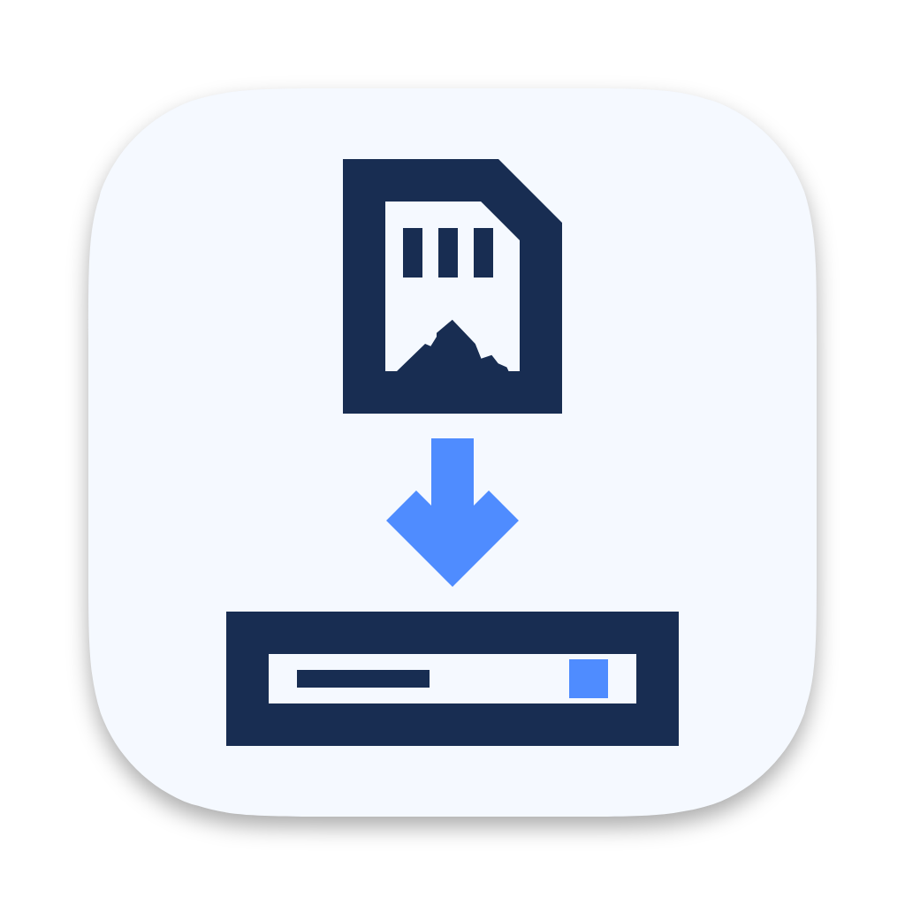

# Media Transfer

A macOS desktop app for videographers to safely offload SD / microSD cards
to an external SSD. Built with Electron + React + TypeScript.

**Version 3.0.0**

Designed for Sony mirrorless bodies (A6700, ZV-E10, etc.) that write to the
`DCIM` and `PRIVATE/M4ROOT/{CLIP,THMBNL}` layout, but flexible enough for
any card via per-drive profiles.



---

## What it does

- Detects connected drives under `/Volumes` and recognizes them by name
- Lets you label each drive as an **Origin** (copy FROM) or **Destination**
  (copy TO)
- For origins, you pick exactly which folders to copy — with a tree picker
- Optionally **flattens** subfolders (e.g. strip Sony's `100MSDCF` so
  photos land directly under `DCIM/`)
- Copies files the first time, then **skips duplicates on re-runs** by
  matching name + size + modification time
- Shows **live progress**: percent, bytes copied, MB/s, elapsed time, ETA,
  and the current file
- **Verifies every copied file**: it is hashed (SHA-256) while it copies,
  read back from the destination and hashed again; only a match gets the
  final name, and every transfer leaves a report file on the destination
- **Never deletes or overwrites** on the destination: two different files
  with the same name both land (see [Verified transfer](#verified-transfer)),
  and it is safe to re-run as often as you want
- **Notifications bell** in the top bar: dismiss a "New drive detected"
  card with × and it stays out of the way (across replugs and relaunches);
  the bell keeps it, with **Label** and **Remove**
- **Thumbnails ride the progress bar** left to right while files copy

---

## Install

### Option A — Download the prebuilt DMG

1. Grab the latest DMG from the [Releases](../../releases) page (or the
   `release/` folder of this repo if you built it yourself).
2. Open the DMG and drag **Media Transfer.app** into `Applications`.
3. First launch: right-click the app → **Open** → **Open**. (The build is
   unsigned; macOS needs you to approve it once.)
4. The first time you transfer, macOS will prompt for **Removable Volume**
   access — approve it in **System Settings → Privacy & Security → Files
   and Folders**.

### Option B — Build it yourself

Requires Node.js 20+.

```bash
git clone https://github.com/eddyvarelae/media-transfer.git
cd media-transfer
npm install
npm run package       # produces release/Media Transfer-*-arm64.dmg
```

Or run it directly without packaging:

```bash
npm start             # builds + launches the app
```

---

## How to use it

### 1. Plug in your drives

Connect both your destination SSD (e.g. my `tars`) and one of your SD
cards. They'll appear under `/Volumes`.

### 2. Label new drives

If the app doesn't recognize a drive, it'll show up under **"New drive
detected"**. Drives you never want to label (Time Machine, scratch disks)
can be dismissed with **×**; they move to the bell in the top bar, where
**Label** (while mounted) and **Remove** stay available. Click **Label this
drive** to set:

- **Label** — a friendly name
- **Role** — Origin (copy FROM) or Destination (copy TO)
- **Folders** (origins only) — tick the folders you want to copy,
  navigating the tree as deep as you need
- **Flatten subfolders** (optional, per folder) — copies every file
  directly into the destination folder, ignoring subdirectories. Ideal for
  Sony's `DCIM/100MSDCF/` layout when you just want all the photos in one
  place.

Seeded profiles on first run:

| Volume      | Role        | Folders                                        | Flatten  |
| ----------- | ----------- | ---------------------------------------------- | -------- |
| `SonyA6700` | Origin      | DCIM, PRIVATE/M4ROOT/CLIP, PRIVATE/M4ROOT/THMBNL | DCIM only |
| `SonyZVE10` | Origin      | DCIM, PRIVATE/M4ROOT/CLIP, PRIVATE/M4ROOT/THMBNL | DCIM only |
| `tars`      | Destination | —                                              | —        |

You can edit or delete any profile later. The **All profiles** list is
collapsed under its header (count + how many are mounted); click it to
expand. The app remembers your choice.

### 3. Pick origin + destination

If multiple origins or destinations are mounted, pick them from the
dropdowns at the top.

### 4. Scan

Click **Scan origin**. The app walks the selected folders, compares them
against the destination, and shows a plan: how many files to copy, how
many to skip, total size per folder.

### 5. Start the transfer

Click **Start transfer**. Watch the live progress — MB/s, elapsed, ETA,
current file — and a second bar for the read-back. Each file is read back
while the next one copies; once the last byte is copied the heading says
**Verifying** until the last read-back is done. You can **Cancel** at any
time.

### 6. Verify

When the transfer finishes, the verification table shows per folder how
many files were copied, verified and skipped: "n files verified", or
"k files failed verification" in red with each failed file listed by
name. A failed file is not on the destination under its name; scan again
to retry it.

### 7. Scan again

Click **Scan origin again** to re-plan after adding more clips, or to
verify that a previous run really covered everything.

---

## Folder layout on the destination

For a card called `SonyA6700` and a destination called `tars`, files land at:

```
/Volumes/tars/SonyA6700/
  ├── DCIM/              ← flat if "flatten" is on, otherwise mirrors card
  │   ├── DSC00001.JPG
  │   └── DSC00002.JPG
  ├── CLIP/
  │   ├── C0001.MP4
  │   └── C0001M01.XML
  └── THMBNL/
      └── C0001T01.JPG
```

Each folder also gets a hidden `.media-transfer/` folder with one report
per transfer (see below). Re-runs add new files only. Nothing is ever
removed from or overwritten on the destination.

---

## Verified transfer

- **Naming rule.** A file keeps its plain name (`DSC00001.JPG`) unless the
  destination already holds a *different* file under that name. Then it
  lands as `<name>-<hash8><ext>` (`DSC00001-9f054d15.JPG`), where `hash8` is
  the first 8 hex characters of the file's SHA-256. Typical case: with
  flatten on, `100MSDCF/DSC00001.JPG` and `101MSDCF/DSC00001.JPG` after the
  camera's counter restarts; the first one copied takes the plain name.
  The same content always gets the same name, so re-runs skip it;
  identical content already under the plain name is a skip, not a twin.
- **Skips on re-runs** match name + size + modification time (2 s
  tolerance) against the plain name and any `-hash8` sibling. Skipped
  files are not read again.
- **Temporary files.** Each file is written as `<name>.mtpart` and renamed
  to its final name only after the read-back matches. Cancel removes the
  temporary files of that transfer. A crash or an unplugged drive can leave
  one behind; it is never counted as copied, and the next transfer to that
  folder removes it. The app only ever removes a temporary file it recorded
  as its own (`temps.json` next to the profiles), and only while the file at
  that name is still the very file it created: a `.mtpart` file it did not
  create is left alone, and that one file is reported as failed. If a
  temporary file can't be removed, the panel says "Cleanup incomplete" and
  the next transfer tries again.
- **Cancelled and failed runs** read "Transfer cancelled" or "Transfer
  finished with failures". Every planned folder gets a row; folders the
  cancel never reached say so. "Copied" counts files placed and verified
  only. A cancelled run's report file says `"cancelled": true` and marks
  the interrupted file `"status": "cancelled"`.
- **Mismatch.** A read-back that doesn't match is copied once more; a
  second mismatch removes the temporary file and marks the file failed.
- **Report file.** After every transfer each folder gets
  `<destination folder>/.media-transfer/transfer-<YYYYMMDD-HHMMSS>.json`:
  `{ version, app, startedAt, finishedAt, origin, destination, flatten,
  files: [{ source, dest, size, mtime, sha256, status }] }`, `status` one of
  `copied-verified`, `skipped`, `failed` (failed entries add a `reason`).
  Skipped files have no hash because they weren't read.
- **Crash or unplug mid-copy.** The next transfer to that folder removes the
  half-written `.mtpart` and copies the file again, on APFS and on exFAT. On
  exFAT the app recognizes it by the drive and creation time it recorded
  when it created the file (exFAT reports a file's real identity only once
  it is closed); a file you put at that path yourself is never touched.
- **Known limit: one writer at a time.** The app assumes nothing else
  writes into the destination folder while a transfer runs. It runs as one
  instance per user (a second launch just brings the first to the front).
- **Known limit: the read-back may come from the macOS file cache.** The
  file was just written, so macOS may serve the read-back from memory
  instead of the drive. Verification proves what macOS reports it wrote,
  not what the medium itself holds.

---

## Configuration

Profiles live at:

```
~/Library/Application Support/Media Transfer/profiles.json
```

Dismissed new-drive notices live next to it in `notifications.json`.

You normally don't need to edit this by hand — use the UI. But you can
back it up, share it, or reset it by deleting the file (the app re-seeds
defaults on next launch).

---

## Scripts

| Script                  | What it does                             |
| ----------------------- | ---------------------------------------- |
| `npm install`           | Install dependencies                     |
| `npm start`             | Build + launch the app                   |
| `npm run build:renderer`| Build the React/Vite renderer            |
| `npm run build:main`    | Build the Electron main + preload bundles |
| `npm run package`       | Full DMG build → `release/`              |

---

## Tech stack

- Electron 29 (main) + Node 20
- React 18 + TypeScript (renderer)
- Vite for the renderer build
- esbuild for the main/preload bundles
- electron-builder for DMG packaging

---

## Caveats

- **Unsigned build.** The DMG isn't code-signed, so macOS asks for approval
  on first launch. Right-click → Open → Open.
- **Apple Silicon build.** The packaged DMG targets arm64. Intel Macs need
  to rebuild with `electron-builder --mac --x64`.
- **No deletion safety net needed** because the app never deletes from
  the destination — it only adds files.

---

## Build history

See [CONVERSATION.md](CONVERSATION.md) for the full build log, including
every prompt and decision from the one-session build with Claude Code.

---

## License

MIT.
